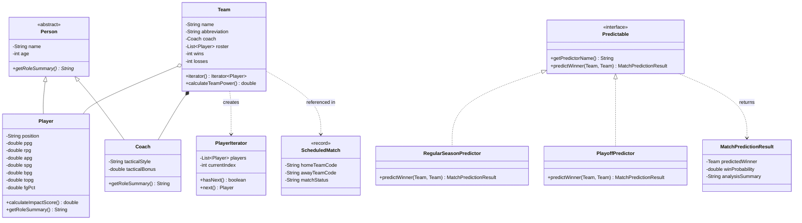

# NBA OOP Analyzer & Match Predictor

A zero-dependency Java console application that fetches live NBA rosters, coaching staff, injury reports, and per-game player statistics from ESPN's public endpoints to analyze player impact and simulate matchup win probabilities.

Built with pure Java (`java.net.http.HttpClient`, `CompletableFuture`, custom JSON parsing, and core Object-Oriented Programming patterns) without external libraries or build frameworks.

---

## Key Architecture & OOP Principles

- **Abstraction & Inheritance (`nba.model`):** Abstract base class `Person` encapsulates shared state and validation (`name`, `age`), extended by `Player` and `Coach` with polymorphic `getRoleSummary()` implementations.
- **Encapsulation & Defensive Copying:** Strict input validation on all constructors/setters, immutable `MatchPredictionResult` value objects, and unmodifiable roster views via `List.copyOf(...)`.
- **Custom Iterator Pattern (`nba.iterator`):** `Team` implements `Iterable<Player>` backed by a custom `PlayerIterator` (`Iterator<Player>`), enabling idiomatic `for (Player player : team)` traversal without exposing internal list references.
- **Strategy Pattern & Polymorphism (`nba.prediction`):** `Predictable` defines a common contract implemented by `RegularSeasonPredictor` and `PlayoffPredictor`, selected dynamically at runtime in `ConsoleMenu`.
- **Modern Java Record & Timezone Conversion (`nba.model`, `nba.network`):** Immutable `ScheduledMatch` record represents daily games fetched from ESPN's live scoreboard, converting UTC tip-off times automatically to Berlin local time (CET/CEST) via `java.time`.
- **Asynchronous Networking & Resilience (`nba.network`):** `NbaApiClient` dispatches non-blocking per-athlete HTTP requests concurrently via `CompletableFuture`, caches loaded `Team` instances in memory, and falls back gracefully to offline rosters if network connectivity is unavailable.
- **Automated Unit Testing (`test/nba/model`):** Comprehensive JUnit 5 test suite verifying constructor bounds, boundary value analysis (`Grenzwertanalyse`), defensive copying immutability, and rotational impact rating algorithms across all model entities.



---

## Prediction Model

1. **Player Impact Score & Shooting Efficiency (`FG%`):** Weighted box-score metrics scaled by an efficiency multiplier relative to the NBA league average (46.0%):
   - `BaseImpact = 1.0*PPG + 1.2*RPG + 1.5*APG + 2.0*SPG + 1.6*BPG - 1.8*TOPG`
   - `Multiplier = 1.0 + ((FG% - 46.0) / 200.0)`
   - `ImpactScore = BaseImpact * Multiplier`
2. **Live Injury Filtering:** Players marked `"status":"Out"` in ESPN's live roster feed are excluded automatically before rating calculation.
3. **Top-8 Rotation & Team Form:** Rather than diluting team strength with end-of-bench garbage-time minutes, `Team.calculateTeamPower()` evaluates the top 8 active rotation players (`1.2x` weight for starters 1–5, `0.6x` weight for bench rotation 6–8), adds the head coach's tactical bonus, and incorporates a live win-percentage form factor `(winPct - 0.50) * 14.0`.
4. **Context-Specific Modes & Pythagorean Win Expectancy:**
   - **Regular Season:** Applies a standard `+2.2` home-court rating bonus.
   - **Playoffs:** Amplifies the team's #1 star (`+0.35 * maxStarImpact`), coaching adjustments (`+0.50 * tacticalBonus`), and home-court intensity (`+3.2`).
   - Win probability is derived via a Pythagorean exponent (`rating^2.8`) to produce realistic separation between contenders and rebuilding teams.

---

## Sample Console Output

> Real console runs captured from live ESPN 2026-27 feeds. Ratings, injuries, and win probabilities update dynamically as real games conclude.

### 1. Single Match Prediction (Option `[4]`)

```text
=== NBA 2026-27 OOP ANALYZER & MATCH PREDICTOR ===
[1] List Supported NBA Teams
[2] Inspect Team Roster & Coach
[3] Player Impact Score Ranking
[4] Simulate Match Prediction
[5] Predict Tonight's NBA Games
[0] Exit
Your choice: 4
Enter home team code to predict (e.g. LAL, BOS, HOU): LAL
Loading live 2026-27 roster for LAL...
Enter away team code to predict (e.g. LAL, BOS, HOU): POR
Loading live 2026-27 roster for POR...
Select Mode ([1] Regular Season, [2] Playoff): 1

=== REGULAR SEASON PREDICTOR ===
Predicted Winner : Los Angeles Lakers [LAL] (Win Probability: 62,5%)
Power Breakdown  : LAL (Home, +2,2 Court Bonus): 42,25 rating vs POR (Away): 35,23 rating
```

### 2. Live Daily Matchups & Batch Prediction in Berlin Time (Option `[5]`)

```text
=== NBA 2026-27 OOP ANALYZER & MATCH PREDICTOR ===
[1] List Supported NBA Teams
[2] Inspect Team Roster & Coach
[3] Player Impact Score Ranking
[4] Simulate Match Prediction
[5] Predict Tonight's NBA Games
[0] Exit
Your choice: 5

=== TONIGHT'S NBA MATCHUPS & PREDICTIONS (BERLIN TIME) ===

Match #1: LAL @ ATL | Tip-off: 01:00 CET
Predicted Winner : Los Angeles Lakers [LAL] (Win Probability: 56,9%)
Power Breakdown  : ATL (Home, +2,2 Court Bonus): 36,94 rating vs LAL (Away): 40,78 rating

Match #2: CLE @ CHA | Tip-off: 01:00 CET
Predicted Winner : Cleveland Cavaliers [CLE] (Win Probability: 81,6%)
Power Breakdown  : CHA (Home, +2,2 Court Bonus): 20,64 rating vs CLE (Away): 35,12 rating

Match #3: WSH @ DET | Tip-off: 01:00 CET
Predicted Winner : Detroit Pistons [DET] (Win Probability: 63,0%)
Power Breakdown  : DET (Home, +2,2 Court Bonus): 35,03 rating vs WAS (Away): 28,95 rating

Match #4: MEM @ TOR | Tip-off: 01:30 CET
Predicted Winner : Toronto Raptors [TOR] (Win Probability: 51,6%)
Power Breakdown  : TOR (Home, +2,2 Court Bonus): 34,50 rating vs MEM (Away): 33,70 rating

Match #5: IND @ DAL | Tip-off: 02:00 CET
Predicted Winner : Dallas Mavericks [DAL] (Win Probability: 70,9%)
Power Breakdown  : DAL (Home, +2,2 Court Bonus): 37,35 rating vs IND (Away): 27,15 rating

Match #6: DEN @ HOU | Tip-off: 02:30 CET
Predicted Winner : Houston Rockets [HOU] (Win Probability: 54,9%)
Power Breakdown  : HOU (Home, +2,2 Court Bonus): 41,56 rating vs DEN (Away): 38,72 rating

Match #7: SA @ PHX | Tip-off: 03:00 CET
Predicted Winner : San Antonio Spurs [SAS] (Win Probability: 64,9%)
Power Breakdown  : PHX (Home, +2,2 Court Bonus): 31,34 rating vs SAS (Away): 39,03 rating

Match #8: NO @ GS | Tip-off: 04:00 CET
Predicted Winner : Golden State Warriors [GSW] (Win Probability: 66,8%)
Power Breakdown  : GSW (Home, +2,2 Court Bonus): 39,31 rating vs NOP (Away): 30,63 rating
```

---

## Project Structure

```text
nba-oop-match-predictor/
├── .gitignore
├── README.md
├── src/
│   ├── Main.java
│   └── nba/
│       ├── iterator/
│       │   └── PlayerIterator.java
│       ├── model/
│       │   ├── Person.java
│       │   ├── Player.java
│       │   ├── Coach.java
│       │   ├── Team.java
│       │   └── ScheduledMatch.java
│       ├── network/
│       │   ├── NbaApiClient.java
│       │   └── SimpleJsonParser.java
│       ├── prediction/
│       │   ├── Predictable.java
│       │   ├── MatchPredictionResult.java
│       │   ├── RegularSeasonPredictor.java
│       │   └── PlayoffPredictor.java
│       └── ui/
│           └── ConsoleMenu.java
└── test/
    └── nba/
        └── model/
            ├── PersonTest.java
            ├── PlayerTest.java
            ├── CoachTest.java
            ├── TeamTest.java
            └── ScheduledMatchTest.java
```

---

## Getting Started

### Prerequisites
- **Java JDK 21+** (developed and tested on JDK 25)
- Internet connection for live ESPN NBA stats (automatically falls back to offline rosters if offline)

### Run in IntelliJ IDEA
1. Open the project folder in IntelliJ IDEA.
2. Open `src/Main.java` and click **Run (`▶`)**.
3. To run the automated unit test suite, right-click the `test` directory and select **Run 'All Tests' (`▶▶`)**.

### Run via Terminal
```bash
javac -d out src/Main.java src/nba/iterator/*.java src/nba/model/*.java src/nba/network/*.java src/nba/prediction/*.java src/nba/ui/*.java
java -cp out Main
```
